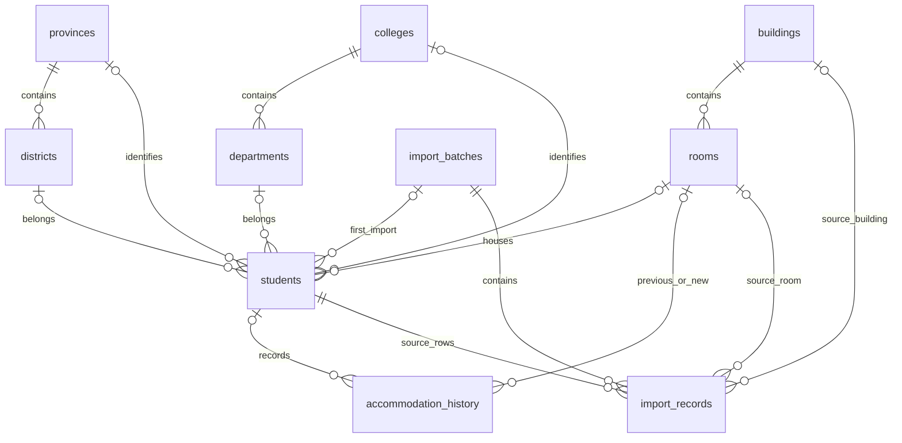

# بنية التطبيق المكتبي

هذه نسخة مستقلة عن مشروع Django الموجود في المجلد الأب. لا تستورد ملفاته أو إعداداته،
ولا تفتح قاعدة بياناته. لا توجد إدارة أسرّة أو حسابات أو أجور أو واجهات ويب في هذه النسخة.

يعرض `main.py` واجهة PySide6 عربية RTL من خلال `QMainWindow` و`QStackedWidget`.
تستدعي الصفحات خدمات مستقلة عن الواجهة، وتستخدم الخدمات SQLAlchemy مع SQLite.
تعمل عمليات التقارير والنسخ والاستعادة في عامل خلفي، وتعود نتائجها إلى الواجهة.
يُحمّل الخط العربي على خيط الواجهة قبل إنشاء PDF في العامل.

الجداول المرجعية الأربعة تحفظ الاسم وحالة التفعيل والمصدر والتوقيتات. يحتوي `buildings`
الرقم/الاسم والجنس والحالة، و`rooms` رقم الغرفة وسعتها وحالتها والبناية التابعة لها.
يحفظ `students` بيانات التسجيل ومعرفاً داخلياً مستقلاً والرقم الجامعي النصي ومراجع القضاء
والقسم والغرفة. لا يحفظ رقم بناية مكرراً؛ تُستخرج البناية من الغرفة.

تضمن مفاتيح مركبة توافق القضاء مع المحافظة والقسم مع الكلية حتى خارج الواجهة.
الرقم الجامعي فريد، ورقم البناية فريد ضمن نوعها (ذكور/إناث)، ورقم الغرفة فريد داخل البناية.
تُشتق الإشغالات من الطلبة المرتبطين بالغرفة.
تمنع مشغلات SQLite تجاوز السعة والتسكين غير المطابق للجنس، وتقليل السعة عن عدد الساكنين،
وتعطيل المرفق المشغول. تُنفذ عمليات الحفظ والنقل داخل `BEGIN IMMEDIATE`؛ SQLite يتيح كاتباً
واحداً ولا يوفر أقفال صفوف. اختبارات الاتصالات المستقلة تتحقق من عدم تجاوز السعة عند التزامن.

يسجل `accommodation_history` الغرفة السابقة والجديدة وتاريخ الحركة. يؤكد المستخدم حذف
الطالب؛ عند الحذف تُحرر الغرفة وتبقى حركة النقل بمعرف طالب فارغ دون كسر العلاقات.
لا تعرض الواجهة حذفاً دائماً للمراجع والبنايات المرتبطة؛ يمكن تعطيل المراجع وحماية الارتباطات.

يحفظ `native_schema` هوية التطبيق وإصدار المخطط. إنشاء الجداول والإصدارات في
`app/database/migrations.py`. ترحيل السجلات القديمة المتوافقة دون رقم جامعي يضيف الحقل
بقيمة فارغة، ويحفظ نسخة أمان، ولا يولد أرقاماً وهمية. يتطلب كل تسجيل جديد رقماً جامعياً؛
تتيح القابلية للقيمة الفارغة الاحتفاظ بالملفات القديمة إلى حين إكمال أرقامها.
تُرفض قواعد Django أو المخططات غير المتوافقة برسالة واضحة بدلاً من حذف البيانات أو إعادة إنشائها.

النسخ الاحتياطي يستخدم SQLite Backup API إلى ملف مؤقت، ويُفحص قبل اعتماده.
تفحص الاستعادة الهوية والمخطط والسلامة والعلاقات قبل الاستبدال، وتنشئ نسخة أمان،
وتغلق الاتصالات، ثم تستبدل الملف وتعيد التحقق. تحتاج النسخة الاحتياطية تخزيناً آمناً؛ ليست مشفرة.

تُحفظ البيانات افتراضياً في `%LOCALAPPDATA%\AlMuthannaDormitoryNative` خارج البرنامج.
ملفات الخط والقوائم وQSS موارد قراءة فقط. يستخدم `QLockFile` لمنع فتح نسختين على المجلد نفسه.
المراجع المحلية محدودة التغطية حسب [توثيق المصادر](reference-sources.md)، ولا تُستكمل بأسماء مختلقة.

## تنسيق التقارير ومعاينتها

تتحقق `report_options.py` من عنوان الكشف واتجاه الصفحة والخط وحقول التوقيع، وتلتقط
الواجهة المرشحات وتاريخ الطلب قبل بدء العامل. يحسب التصدير العدد من الصفوف التي استخرجها
فعلياً؛ حد المعاينة الجدولية البالغ 100 صف لا يحد عدد صفوف الملف المصدّر.
تحافظ `export_service.py` على ترتيب الأعمدة المختارة، وتضيف التسلسل عند اختياره فقط.
ورقة الطلبة هي الأولى في Excel، وتليها ورقة الملخص، مع إعدادات طباعة مستقلة.

تعرض `report_preview.py` نفس PDF الناتج بواسطة QtPdf داخل نافذة أصلية. يُحمّل الملف
إلى مخزن بايتات خاص بالمعاينة؛ الحفظ ينسخ هذه البايتات نفسها، ولا يعيد الاستعلام أو توليد
التقرير بعد المراجعة. تُغلق موارد العرض عند الإغلاق أو الإلغاء، وتُحذف ملفات المعاينة
المؤقتة بعد استخدامها. تُنظف الملفات المتبقية من انقطاع سابق بعد 24 ساعة، ولا تحل هذه
الآلية محل حماية حساب Windows ومجلد البيانات.

يربط مُصدّر PDF تخطيط النص بدقة جهاز PDF لضبط حجم الخط، ثم يفصل مراجع جهاز الرسم
من المستندات قبل تحريره في مساري النجاح والفشل. تغطي الاختبارات عمر هذه الموارد حتى
لا يترك التصدير مؤشراً إلى جهاز رسم محرر.

تُحفظ القوالب المحلية في `report-profiles.json` داخل مجلد البيانات باستخدام استبدال ذري
للملف. تحفظ العنوان والتنسيق والأعمدة فقط، ولا تحفظ البحث أو المرشحات أو صفوف الطلبة.
لا تتطلب هذه الإضافة تغيير مخطط SQLite. راجع [دليل التقارير](report-formatting.md).

تستخدم التقارير الورق A4 دائماً. تبقى عناوين جدول الطلبة وقيمه بسطر واحد: يقيس
PDF النص الكامل لتوزيع الأعمدة، ويعامل حجم الخط المختار كحد أعلى، ويضبطه حتى
6 نقاط عند الحاجة، ثم يضغط النص الطويل أفقياً داخل خليته دون حذف أحرفه.
تنتقل الصفوف كاملة إلى صفحات A4 إضافية مع تكرار العناوين.
يستخدم Excel تعطيل الالتفاف وتصغير النص ليلائم الخلية، مع طباعة عرض صفحة A4 واحدة.
تتحول فواصل الأسطر إلى مسافات في نسخ التقارير فقط، وتبقى البيانات المسجلة كما هي.

## استيراد سجلات سابقة ناقصة

الإصدار 2 من المخطط يضيف `import_batches` و`import_records`. تحفظ الدفعة اسم الملف
وبصمته والسنة الدراسية، ويحفظ كل سجل مصدر الورقة ورقم الصف والقيم الأصلية وملاحظات
المراجعة وبصمة المحتوى. لا تُستخدم الأسماء وحدها كمعرّفات، ولا يُعاد إنشاء الطلبة
عند تكرار الملف نفسه. لا يحوي ملف تشغيل البرنامج أو حزمته بيانات الاستيراد الشخصية.

تبقى شروط التسجيل اليدوي كما هي. يسمح سجل مرتبط بدفعة استيراد بغياب الرقم الجامعي
وبعض المراجع وبيانات ولي الأمر دون إنشاء بدائل وهمية؛ تضمن قيود القاعدة توافق
المراجع متى وُجدت. تستخدم استعلامات العرض علاقات خارجية حتى تظهر السجلات الناقصة،
وتُحسب حالة الاكتمال من الحقول نفسها دون تخزين عداد أو حالة قديمة مكررة.
لا تُخصص غرفة حالية لسجل مستورد ناقص. بيانات السكن في الملف السابق محفوظة كنص
مصدر للمراجعة فقط، ولا تنشئ تسكيناً أو انتقالاً أو غرامة مالية حالية.

يسبق ترحيل الإصدار 1 نسخة SQLite Backup موثوقة. يعاد بناء جدول الطلبة داخل معاملة
واحدة مع حفظ المعرّفات والقيم القديمة والتاريخ والفهارس والمشغلات والعروض المعروفة؛
تُرفض إضافات المخطط المحلية غير المعروفة بدلاً من حذفها. تبقى نسخ الإصدار 1 قابلة
للفحص والاستعادة والترقية. ينفذ الاستيراد نفسه في `BEGIN IMMEDIATE` واحد، بعد حجز
`application.lock` وأخذ نسخة أمان. تعاد سلامة القاعدة والعلاقات بعد التنفيذ.
راجع [دليل السجلات المستوردة](student-import.md).

الإصدار 3 يربط سجل المصدر اختيارياً ببناية وغرفة حقيقيتين، مع مفتاح مركب يمنع ربط
غرفة ببناية مختلفة. لا يغيّر هذا الربط `students.room_id` أو `accommodation_history`.
تسمح الغرفة غير المفعّلة بسعة `NULL` عند غياب السعة في المصدر؛ يمنع قيد القاعدة
تفعيلها قبل تحديد سعة صحيحة. لا تُحتسب الغرف المجهولة السعة ضمن السعات أو الشواغر
التشغيلية، وتعرض الواجهة نقصها صراحةً. تبقى عقود الإصدارين 1 و2 محفوظة للتحقق من
النسخ واستعادتها، ويجري الترحيل بالتتابع مع نسخة أمان قبل كل خطوة.
