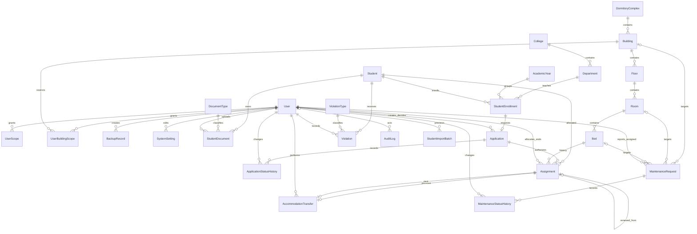

# Architecture and relational database design

## Scope and delivery boundary

The original modular Django 5.2 architecture is preserved. The active deployment
uses SQLite on one Windows computer, as explicitly requested after the initial
MySQL foundation. Operational workflows, Arabic UI, scoped authentication, dashboard,
reports and backup/recovery are implemented. See README and delivery.md for current
setup and validation; old MySQL investigation notes are historical.

Python 3.12+ is supported; validation used Python 3.14.4 with SQLite 3.50.4.
The persisted generated columns require SQLite 3.31+ (Django checks compatibility).
No MySQL service is needed. Optional legacy settings are retained without altering
any MySQL database or credentials; workflow equivalence on that backend is not claimed.

## Modules and table descriptions

Application models use BigAutoField primary keys; Django's own models follow its migrations. Except AuditLog (immutable event time),
all models carry created_at and updated_at. Django manages authentication tables,
groups, permissions, sessions, and migration history.

| App / model | Purpose / keys and relationships |
|---|---|
| accounts.User | Django AbstractUser, unique username, password hashes; groups and permissions |
| accounts.UserScope | Explicit gender grant per user; unique (user, gender) |
| accounts.UserBuildingScope | Explicit building grants, unique (user, building); combined with gender scope |
| accounts.LoginThrottle | Persistent local login/recovery throttling; keyed hash, count and window start |
| accounts.SystemSetting | Unique configuration key, JSON value, protected last editor |
| academics.College | Unique name and code; deactivate instead of deleting |
| academics.Department | Protected college; unique code and (college, name) |
| academics.AcademicYear | Unique name; ordered dates; application intake flag |
| academics.StudentEnrollment | Protected student/year/department; unique (student, year); stage 1–8 |
| students.Student | Unique university number, contact/address/guardian information, gender, birth date, active flag |
| students.DocumentType | Configurable document requirements and photograph classification |
| students.StudentDocument | Protected student/type/uploader, private file with randomized path; multiple versions retained |
| dormitories.DormitoryComplex | Unique name, gender, address, active flag |
| dormitories.Building | Protected complex; unique (complex, name) |
| dormitories.Floor | Protected building; unique (building, number), supports ground/basement floors |
| dormitories.Room | Protected floor; unique (floor, number); operational status |
| dormitories.Bed | Protected room; unique (room, number); operational status |
| applications.Application | One per enrollment; draft/submitted/review/approved/rejected/cancelled; protected creator/decision maker |
| applications.ApplicationStatusHistory | Protected application/actor; timestamped from/to state and reason |
| accommodations.Assignment | Protected student/application/bed/actors; allocation, check-in and end timestamps; generated unique active keys |
| common.BackupRecord | UUID download identity, protected creator, size, creation/update times; no user-controlled path |
| accommodations.AccommodationTransfer | Protected one-to-one old/new assignments and actor; reason |
| violations.ViolationType | Configurable unique type, active flag; no invented disciplinary policy |
| violations.Violation | Protected student/type/employee; date, description, administrative action |
| maintenance.MaintenanceRequest | Exactly one protected target (building, room, bed); category, priority, status, actors, completion time |
| maintenance.MaintenanceStatusHistory | Protected request/actor, from/to status, note |
| audit.AuditLog | Protected optional actor; action, object identity, safe JSON metadata, event timestamp |

Foreign keys are indexed by Django. Additional indexes cover gender/active students,
year/department enrollments, application status/date, bed operational status,
active assignments, student accommodation history, maintenance status/priority and
audit object/time lookup. Unique constraints also supply indexes. Nullable fields
represent genuinely optional events/targets, never missing mandatory identity data.
All historical relationships use PROTECT. Only user-scope grants cascade with a
user. Users and historical students should be deactivated. No deletion UI exists.

## Normalization

College is derived from enrollment.department.college. Stage, study status and
department belong to the annual enrollment, not the student profile. An application
references that enrollment; renewal uses a new year's enrollment/application.
Room/building/complex are derived from bed rather than duplicated on an assignment.
A maintenance target stores exactly one level and derives its ancestors. Photograph
files are StudentDocuments with a photograph DocumentType. Document requirements
are configured by authorized staff, not claimed as official university policy.

Assignment.student is deliberate controlled redundancy: MySQL cannot enforce a
unique active student across a join to enrollment. The future allocation service
must derive it from application.enrollment.student, never accept it independently.
Model clean validates the relationship; bulk writes bypass clean and must not be
exposed. Generated columns are derived index keys, not independent business data.

## Active assignment guarantee

The existing cross-backend schema retains two STORED generated unique columns.
SQLite supports these and their uniqueness is exercised by the integration suite.
The columns evaluate:

```sql
CASE WHEN ended_at IS NULL THEN student_id ELSE NULL END
CASE WHEN ended_at IS NULL THEN bed_id ELSE NULL END
```

Each has an ordinary UNIQUE index. SQLite permits multiple NULL values, preserving
all completed history while rejecting two active reservations for a student or bed,
including competing transactions. An allocation reserves a bed immediately;
checked_in_at is a separate physical-arrival event. Available beds exclude active
allocations and unavailable ancestors. Occupancy/resident metrics must distinguish
reserved beds from checked-in residents; no mutable counters are stored.

Allocation/transfer/check-out/renewal run in short transaction.atomic blocks using
SQLite IMMEDIATE mode. They re-read eligibility after acquiring the writer reservation,
and structural status/parent edits use the same strategy. This is database-wide writer
serialization, not row locking; select_for_update is not relied on. The services check
approval, enrollment/student activity, gender, availability and all operational ancestors.
Conflict exceptions are handled outside the atomic block. Transfer ends/creates/logs
in one transaction. Renewal has a protected one-to-one renewed_from link. Check-out
sets ended_at and ended_by together; CHECK constraints order the timestamps.
Cross-table eligibility/gender rules require the services because SQL CHECK constraints
cannot contain joins. Model.clean is defense in depth, not the concurrency boundary.
SQLite text-length and case-comparison semantics are not asserted identical to MySQL;
forms/full_clean enforce field lengths, and existing SQLite unique indexes use their
configured collation. Tests verify the actual critical database constraints and races.

## Security boundary

Settings fail closed without a random secret and never publish MEDIA_URL. The local
HTTP deployment is loopback-only; HTTPS/secure-cookie mode remains configurable.
Documents are streamed as attachments after permission AND scope checks, with
nosniff/private cache control. Photographs use a separate authorized, re-encoded PNG thumbnail.
Upload validation limits files to 5 MiB PDF/JPEG/PNG, checks signatures/images and
uses UUID filenames. PDFs are not malware-scanned: deploy an approved scanner or
quarantine pipeline before accepting untrusted production uploads. Validation must
run through forms/services; FileField.save alone does not invoke validators.

Backend policies now enforce gender/building scopes on lists, objects, exports,
downloads, FK choices and service writes. No staff group implicitly grants a gender.
Audit writes accompany sensitive service operations; arbitrary raw database/shell
changes are outside that boundary. There is no audit-edit/delete endpoint. JSON
settings have a typed allowlisted editing form. Credentials, document contents and
personal snapshots are not logged. In SQLite, Windows file ownership is the outer
security boundary; there is no independent database-user permission layer.

The explicitly enabled local no-login mode intentionally gives all local browser
users full access through an unusable-password technical actor. It does not preserve
individual employee separation while enabled; see local-no-login.md and phase-2.md.

## Database ERD



Maintenance target relationships are mutually exclusive. Django Groups/Permissions
provide RBAC tables; separate Roles would duplicate Django functionality.

StudentImportBatch stores an owner-protected UUID, validated preview payload, expiry,
commit timestamp and count. Confirmation revalidates every row in one transaction;
completed/expired payloads are cleared. It does not replace Student or StudentEnrollment.
Application(status, updated_at) and MaintenanceRequest(status, created_at) indexes support alerts.
Desktop resources resolve from RESOURCE_DIR; writable settings/database/uploads/backups
resolve from DORMITORY_DATA_DIR. Waitress binds only to 127.0.0.1. The installer copies
only executable/runtime files and preserves the preceding installation on updates.
